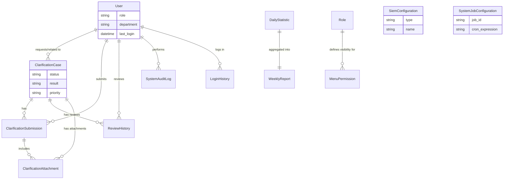

# Database ERD (Entity Relationship Diagram)

## 1. Logical ERD (High-Level)

이 다이어그램은 SICS 시스템의 고수준 메인 엔티티와 이들 간의 핵심 관계를 직관적으로 나타냅니다.

## 2. Physical ERD (Detailed Schema)

전체 테이블, 컬럼명, 데이터 타입 및 외래키 제약조건을 나타내는 상세 물리 스키마입니다. (보안 목적의 Case Locking 필드 포함)

```mermaid
erDiagram
    users {
        int user_id PK "자동 증가"
        string user_email UK "고유 인덱스"
        string user_name
        string hashed_password
        string company
        string department
        enum role "USER, SECURITY_ADMIN, AUDIT_TEAM, SYSTEM_ADMIN"
        datetime last_login "마지막 로그인 시간"
        datetime idate "생성일"
        datetime udate "수정일"
    }

    clarification_case {
        int case_id PK "자동 증가"
        enum siem_type "SENTINEL, ELK, SPLUNK"
        string rule_title
        text rule_description
        int incident_num
        text summary
        enum case_type "정보유출, 보안위반, 시스템접근, 권한오남용"
        int related_employee_id FK "소명 대상자"
        int requester_id FK "케이스 생성자"
        datetime created_at "생성 시간"
        datetime due_date "마감일"
        enum case_status "UNCLASSIFIED, REQUEST, SUBMIT, APPROVE, REJECT, CLOSE"
        enum case_result "JUSTIFIED, FALSE_POSITIVE, MINOR_VIOLATION, INSUFFICIENT, EDUCATION_NEEDED, DISCIPLINARY_ACTION"
        enum priority "LOW, MEDIUM, HIGH"
        datetime final_review_date "최종 검토일"
        int final_reviewer_id FK "최종 검토자"
        text original_log_link "원본 로그 링크"
        int locked_by_id FK "현재 편집 중인 관리자 (Case Locking)"
        datetime locked_at "잠금 시작 시간 (Case Locking)"
    }

    clarification_submission {
        int submission_id PK "자동 증가"
        int case_id FK "연결된 케이스"
        int submitter_id FK "제출자"
        datetime submitted_at "제출 시간"
        text content "소명 내용"
        string classification "분류"
    }

    clarification_attachment {
        int file_id PK "자동 증가"
        int submission_id FK "연결된 제출"
        int case_id FK "연결된 케이스"
        string original_filename "원본 파일명"
        string stored_filename "저장 파일명"
        text file_path "파일 경로"
        int file_size "파일 크기 (bytes)"
        datetime uploaded_at "업로드 시간"
    }

    review_history {
        int review_id PK "자동 증가"
        int case_id FK "연결된 케이스"
        int reviewer_id FK "검토자"
        datetime reviewed_at "검토 시간"
        enum case_status "검토 후 상태"
        enum case_result "검토 결과"
        text comments "검토 의견"
    }

    system_audit_log {
        int log_id PK "자동 증가"
        datetime occurred_at "발생 시간"
        int actor_id FK "작업 수행자"
        text action "수행 작업 명세"
        string ip_address "접속자 IP 주소"
    }

    login_history {
        int login_id PK "자동 증가"
        int user_id FK "사용자"
        datetime login_at "로그인 시각"
        string ip_address "IP 주소"
        string status "SUCCESS 등 상태"
    }

    siem_configuration {
        int siem_id PK "자동 증가"
        enum siem_type "SENTINEL, ELK, SPLUNK"
        string name "엔드포인트 명"
        string host_url "호스트 URL"
        string tenant_id "테넌트 ID"
        string client_id "클라이언트 ID"
        string client_secret "클라이언트 시크릿 (AES-256 암호화 보관)"
        string subscription_id "구독 ID"
        string resource_group "리소스 그룹"
        string workspace_name "워크스페이스 명"
        string api_key "API Key (AES-256 암호화 보관)"
        text test_query "테스트 쿼리"
        json field_mapping "커스텀 필드 매핑 룰"
        boolean is_active "활성화 여부"
        datetime created_at "생성일"
        datetime updated_at "수정일"
    }

    integration_setting {
        string provider PK "연동 종류 (ENTRA)"
        boolean is_enabled "사용 여부"
        string tenant_id "테넌트 ID"
        string client_id "클라이언트 ID"
        string client_secret "클라이언트 시크릿 (Fernet 암호화 보관)"
        string mail_sender "Outlook 발송 사서함"
        int updated_by FK "마지막 수정자 (users)"
        datetime updated_at "수정일"
    }

    daily_statistic {
        datetime stat_date PK "통계 일자 (Primary Key)"
        int unclassified_count "미확인 건수"
        int request_count "소명 요청 건수"
        int submit_count "소명 제출 건수"
        int reviewed_count "검토 완료 건수"
        datetime created_at "생성일"
    }

    weekly_report {
        int report_id PK "자동 증가"
        date week_start UK "주의 시작일 (월요일)"
        date week_end "주의 종료일 (일요일)"
        int created_count "주간 발생 건수"
        int approved_count "주간 승인 건수"
        int rejected_count "주간 반려 건수"
        datetime generated_at "보고서 생성 시간"
    }

    system_job_configuration {
        string job_id PK "작업 식별자 (e.g., daily_statistics)"
        string name "작업 표시 이름"
        string description "작업 설명"
        string cron_expression "크론 스케줄링 표현식"
        boolean is_active "작업 활성화 여부"
        datetime created_at "생성일"
        datetime updated_at "수정일"
    }

    menu_permissions {
        int id PK "자동 증가"
        enum role "USER, SECURITY_ADMIN, AUDIT_TEAM, SYSTEM_ADMIN (UK 1)"
        string menu_path "메뉴 경로 (e.g., /siem) (UK 2)"
        boolean is_visible "메뉴 노출 여부"
        datetime created_at "생성일"
        datetime updated_at "수정일"
    }

    users ||--o{ clarification_case : "related_employee_id"
    users ||--o{ clarification_case : "requester_id"
    users ||--o{ clarification_case : "final_reviewer_id"
    users ||--o{ clarification_case : "locked_by_id"
    users ||--o{ clarification_submission : "submitter_id"
    users ||--o{ review_history : "reviewer_id"
    users ||--o{ system_audit_log : "actor_id"
    users ||--o{ login_history : "user_id"

    clarification_case ||--o{ clarification_submission : "case_id"
    clarification_case ||--o{ review_history : "case_id"
    clarification_case ||--o{ clarification_attachment : "case_id"

    clarification_submission ||--o{ clarification_attachment : "submission_id"
```

## 3. 성능 최적화 인덱스 구조 (Query Optimization)

대량 데이터 환경 하에서 목록 조회 및 필터 조회의 속도를 보장하기 위해 선언된 복합 인덱스입니다.

### ClarificationCase 테이블

- `idx_case_status`: (`case_status`) (상태별 케이스 목록 조회 성능 향상)
- `idx_employee_status`: (`related_employee_id`, `case_status`) (특정 직원에게 할당된 활성 케이스 목록 조회 시 N+1 방지)
- `idx_created_at`: (`created_at`) (최신 인시던트 조회 및 기간 필터링 최적화)

### ReviewHistory 테이블

- `idx_review_case_id`: (`case_id`) (단일 케이스의 타임라인 조회 시 최적화)
- `idx_review_reviewer_id`: (`reviewer_id`) (관리자 본인이 이력 남긴 리뷰 건 역추적 속도 향상)

### ClarificationSubmission 테이블

- `idx_submission_case_id`: (`case_id`) (단일 케이스에 종속된 소명서 조회 최적화)
- `idx_submission_submitter_id`: (`submitter_id`) (작성자 기준 내역 리스팅 시 최적화)

### LoginHistory 테이블

- `idx_login_user_id`: (`user_id`) (특정 유저의 접속 내역 조회 성능 최적화)
- `idx_login_at`: (`login_at`) (특정 일자의 로그인 통계, 부정 로그인 감지 분석 시 활용)

## 4. 데이터베이스 관계 및 주요 기능 동작 해설

### User → ClarificationCase

단일 사용자는 케이스 생명주기 내에서 여러 복합적 역할을 점유할 수 있습니다:

- **related_employee_id**: 위반자로 의심되어 소명서를 요청받는 당사자입니다.
- **requester_id**: 최초 이벤트(알람)를 생성 또는 인지하여 소명을 요구한 1차 보안 관리자입니다.
- **final_reviewer_id**: 대상자의 소명을 읽고 최종 `승인` 혹은 `반려`를 확정한 2차/최종 보안 팀원입니다.
- **locked_by_id**: (v1.3.0) 현재 UI 상세보기를 진입하여 조작 권한(Lock)을 쥐고 있는 담당자입니다.

### ClarificationCase ↔ ReviewHistory / Submission

- 1개의 케이스(`ClarificationCase`)는 반려 후 재제출이 발생할 수 있으므로, 1:N 관계로 `ClarificationSubmission`가 쌓입니다.
- 케이스의 결재 상태(`REQUEST` → `SUBMIT` → `REJECT` → `SUBMIT` → `APPROVE`)가 변경될 때마다 당시 뷰를 기록하기 위해 `ReviewHistory` 이력 레코드가 스냅샷 형태로 계속 누적(1:N)됩니다.

### SIEM Configuration & Encryption

- **SiemConfiguration** 내 크레덴셜 정보(`client_secret`, `api_key`)는 SQLAlchemy ORM을 타기 직전 서버측 로직(`backend.core.encryption`)에 의해 AES-256 Fernet 알고리즘으로 암호화되어 DB상 복호화 불가능한 상태로 보관됩니다. (보안 고도화 요구사항 반영)
- `field_mapping` 컬럼은 JSON 타입으로 구성되어, 시스템 고정 스키마 외에 다양한 이기종 SIEM(Sentinel, Splunk, Elastic)에서 전달되는 가변 로그 필드들을 자유롭게 저장할 수 있는 확장성을 확보합니다.

### Integration Setting (선택 연동)

- **IntegrationSetting**: 설치 후 관리자가 설정하는 외부 연동 정보입니다. 연동 종류(`provider`)마다 1행이며 현재는 `ENTRA`(SSO·사용자 동기화·Outlook 메일)만 사용합니다.
- 행이 없거나 `is_enabled=false`이면 Entra 관련 기능은 꺼진 상태로 동작합니다. `.env`/프론트 빌드 변수에는 연동 정보를 두지 않습니다.
- `client_secret`은 Fernet으로 암호화되어 저장되며 API 응답에는 설정 여부(`client_secret_set`)만 내려갑니다. 마이그레이션: `0003`.

### Dynamic System Configuration (v1.4.0)

- **SystemJobConfiguration**: 기존 코드에 하드코딩 되어있던 스케줄링(Cron) 정보가 데이터베이스로 분리되어 웹 UI에서 동적으로 수정하고 백엔드 서비스 재시작 없이 즉시 반영할 수 있게 지원합니다.
- **MenuPermission**: 각 사용자 역할(Role)마다 볼 수 있는 사이드바 메뉴가 하드코딩 형태에서 DB 기반 매핑 구조로 전환되었습니다. 이를 통해 관리자가 자유롭게 메뉴 접근 권한을 시각적으로 통제할 수 있습니다.

---

**작성일**: 2026-02-17  
**최종 수정**: 2026-03-06 (v1.4.0 동적 스케줄링 및 역할별 권한 테이블 추가 반영)
